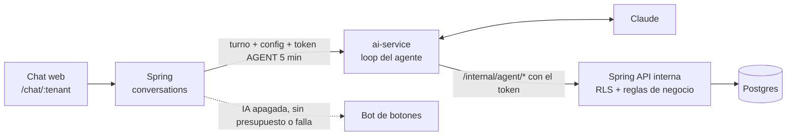

# Turnos SaaS — Barbería con chatbot de WhatsApp

Plataforma SaaS multi-tenant de turnos para barberías, con dashboard web para el administrador y un chatbot de WhatsApp para el cliente final.

La especificación completa y vinculante del producto vive en `ESPECIFICACION-TECNICA.md` en la raíz del proyecto (documento interno, no versionado en este repo). Ese documento es la única fuente de verdad — cualquier duda de comportamiento se resuelve ahí, no acá.

## Estructura del repo

```
backend/     Java 21 + Spring Boot 4 (API REST, dominio, bot in-process)
frontend/    React (Vite + TS) — dashboard SPA + chat público
ai-service/  Python 3.13 + FastAPI — agente de IA (tool calling) y evals
docs/adr/    Decisiones de arquitectura del asistente
docker-compose.yml
```

## Stack

- **Backend**: Java 21, Spring Boot 4, PostgreSQL 16 con Row-Level Security para aislamiento multi-tenant, Flyway para migraciones.
- **Frontend**: React + TypeScript + Vite, sin librerías de UI/estado adicionales (`fetch` nativo, React Router).
- **Chatbot de WhatsApp**: motor de conversación corre in-process dentro del backend; el proveedor de WhatsApp Business API está abstraído detrás de la interfaz `WhatsAppProvider` (implementación real pendiente de elegir BSP — ver "Decisiones abiertas" abajo). En dev/test se usa `LoggingWhatsAppProvider`, que solo loguea los mensajes salientes.
- **Asistente de IA**: servicio Python aparte (FastAPI + Pydantic, loop de agente propio, Anthropic `claude-haiku-5-5` por default). Atiende el chat web; Spring sigue siendo el dueño de los datos y valida cada acción. Ver "Asistente de IA" abajo.
- **Infra**: Docker Compose con 4 servicios (`postgres`, `backend`, `ai`, `frontend` servido por nginx).

Ver sección 9 de la especificación técnica para el detalle completo y las razones de cada elección.

## Cómo levantar el proyecto

### Con Docker Compose (recomendado — stack completo)

```bash
docker compose up -d --build
```

Esto levanta los 4 servicios:

| Servicio | Puerto | Descripción |
|---|---|---|
| `postgres` | 5433 → 5432 | Postgres 16, con healthcheck |
| `backend` | 8080 | API REST Spring Boot |
| `ai` | — (solo red interna) | Agente de IA. Sin `ANTHROPIC_API_KEY` en tu shell, el chat cae al menú de botones |
| `frontend` | 8081 → 80 | nginx sirviendo el build estático; `/api/*` se reenvía al backend |

Para el asistente: `ANTHROPIC_API_KEY=... docker compose up -d --build` y abrir `http://localhost:8081/chat/<tenantId>` (el link exacto aparece en la pantalla **Asistente** del dashboard).

Abrir `http://localhost:8081` — el dashboard queda ahí, autenticado contra la API real vía el proxy de nginx.

`docker compose down` para bajar todo. `docker compose up -d --build` de nuevo cuando cambie código del backend o del frontend (el build ocurre dentro de la imagen, no hace falta compilar antes a mano).

### En desarrollo local (hot reload)

Backend y frontend corren cada uno por su cuenta; solo Postgres se levanta con Docker:

```bash
docker compose up -d postgres
cd backend && SPRING_DATASOURCE_PASSWORD=turnos_app JWT_SECRET=$(openssl rand -base64 32) ./mvnw spring-boot:run
cd frontend && npm install && npm run dev
```

En PowerShell las variables van aparte: `$env:JWT_SECRET = "..."` y `$env:SPRING_DATASOURCE_PASSWORD = "turnos_app"` antes del `./mvnw`. Son las dos únicas obligatorias (ver tabla abajo); Compose las fija solas, pero corriendo el backend a mano hay que pasarlas.

El frontend en modo dev (`npm run dev`, puerto 5173) tiene un proxy propio (`vite.config.ts`) que reenvía `/api` a `http://localhost:8080`, así que no hace falta configurar CORS para desarrollar así.

### Alta del primer tenant

No hay autoregistro público (spec sección 2). El alta de un tenant es manual, vía un Super Admin:

1. Seedear un Super Admin al levantar el backend con las variables `SUPERADMIN_EMAIL` / `SUPERADMIN_PASSWORD` (ver tabla de variables de entorno abajo) — solo siembra la cuenta si no existe ya una con ese email.
2. Loguearse como ese Super Admin y usar `POST /api/admin/tenants` (o la pantalla mínima `/`) para crear el tenant, su primera sucursal y el primer usuario Admin, todo en un solo paso.

## Variables de entorno

`JWT_SECRET` y `SPRING_DATASOURCE_PASSWORD` son obligatorias: sin ellas el backend no arranca. Compose fija valores de dev para las dos, así que `docker compose up` funciona tal cual; correr el backend por fuera de Compose las pide. El resto tiene un default razonable para desarrollo local.

| Variable | Default | Uso |
|---|---|---|
| `SPRING_DATASOURCE_URL` | `jdbc:postgresql://localhost:5432/turnos` (Compose la fija a `postgres:5432`) | Conexión a Postgres |
| `SPRING_DATASOURCE_USERNAME` | `turnos_app` | Rol de aplicación — nunca el superusuario, RLS depende de eso |
| `SPRING_DATASOURCE_PASSWORD` | **sin default** (Compose fija el de dev) | Contraseña de ese rol. En dev la fija `postgres-init/init-app-role.sql`; en producción la ponés vos |
| `JWT_SECRET` | **sin default** (Compose fija uno de dev) | Clave HMAC para firmar los JWT de sesión, en base64 de al menos 32 bytes: `openssl rand -base64 32`. El valor de Compose es público y sirve solo para desarrollo. |
| `JWT_EXPIRATION_SECONDS` | `86400` (24h) | Vencimiento del JWT — no hay refresh token (spec sección 11) |
| `SUPERADMIN_EMAIL` / `SUPERADMIN_PASSWORD` | vacío (no siembra nada) | Si ambas están seteadas y no existe ya una cuenta con ese email, se crea un Super Admin al arrancar |
| `PORT` | `8080` | Puerto en el que escucha el backend. Lo inyectan solas las plataformas tipo Render |
| `CORS_ALLOWED_ORIGINS` | vacío (sin headers CORS) | Orígenes permitidos, separados por coma. Vacío es lo correcto cuando el frontend y la API comparten origen, como acá: nginx en Compose y el proxy de Vite en dev |

### Asistente de IA

| Variable | Dónde | Default | Uso |
|---|---|---|---|
| `AI_SERVICE_URL` | backend | vacío (IA apagada: el chat usa el menú de botones) | URL de `ai-service` |
| `AI_SERVICE_TOKEN` | backend y ai | **sin default** en ai (rechaza todo) | Secreto compartido de las llamadas backend → ai |
| `AI_DAILY_BUDGET_USD` | backend | `0` (sin tope) | Tope global diario de gasto en LLM, todos los tenants |
| `CHAT_RATE_LIMIT_PER_MINUTE` | backend | `20` | Mensajes por minuto por IP y por sesión en el chat público |
| `TURNSTILE_SECRET` | backend | vacío (sin captcha) | Cloudflare Turnstile en sesiones nuevas del chat. El frontend necesita `VITE_TURNSTILE_SITE_KEY` |
| `FORWARD_HEADERS_STRATEGY` | backend | `none` | `framework` detrás de un proxy (Render), para que el rate limit vea la IP real |
| `ANTHROPIC_API_KEY` | ai | — | Clave del proveedor |
| `AI_MODEL` / `AI_EFFORT` | ai | `claude-haiku-5-5` / `low` | Modelo y nivel de effort del agente |
| `CORE_BASE_URL` | ai | `http://localhost:8080` | Dónde está el backend (para `/internal/agent/*`) |

### Solo del perfil `demo`

El perfil `demo` (la demo pública: ver `DEPLOY.md`) se activa **únicamente**
con `SPRING_PROFILES_ACTIVE=demo`. Sin esa variable, las clases de seed y el
endpoint de reseteo no se cargan y `/api/demo/reset` responde 404 — hay un
test que lo verifica (`DemoProfileAbsentTest`).

| Variable | Default | Uso |
|---|---|---|
| `DEMO_ADMIN_EMAIL` / `DEMO_ADMIN_PASSWORD` | vacío (no siembra nada) | Credenciales del admin del tenant de demo |
| `DEMO_RESET_TOKEN` | vacío (endpoint apagado, 404) | Token de `POST /api/demo/reset`, en el header `X-Demo-Reset-Token` |
| `DEMO_SEED_ON_STARTUP` | `true` | `false` no regenera los datos al arrancar |
| `DB_POOL_MAX` | `5` | Tamaño máximo del pool Hikari |

En el frontend, `VITE_API_BASE_URL` apunta la SPA a otra URL de API (por
default `/api`, mismo origen), y `VITE_DEMO_EMAIL` / `VITE_DEMO_PASSWORD`
hacen aparecer el cartel con las credenciales en el login. Sin definirlas,
no hay cartel.

## Asistente de IA

Un agente con herramientas, no un "chat con contexto": el modelo consulta y propone acciones con tool calling, y **el backend decide**. Diseño completo en `propuesta-arquitectura-ia.md`; las decisiones clave, en `docs/adr/`.



- **Herramientas** (`ai-service/app/tools.py`): info del local, servicios, profesionales, disponibilidad, identificar cliente, mis turnos, perfil, reservar/cancelar/reprogramar en dos pasos (`prepare_*` + `commit_*`) y derivar a una persona. El tenant, la conversación y el cliente salen del token y de la base, nunca de lo que escribe el modelo.
- **Precisión medida por código** (`BookingDraftResolver`): el modelo pasa las palabras literales del cliente ("el jueves", "tipo 10") y Spring decide si reserva directo (AUTO) o pide confirmación (CONFIRM). Un borrador CONFIRM solo se confirma si hay un mensaje del cliente posterior al borrador.
- **Configuración del dueño** versionada (pantalla **Asistente**): nombre, tono, voseo, emojis, políticas, qué puede hacer, modo de confirmación, presupuesto mensual. Se prueba en un playground (reservas simuladas) antes de publicar.
- **Guardrails**: límite de mensajes por IP/sesión, captcha opcional, tope diario global y presupuesto mensual por local; horarios y precios de la respuesta se verifican contra lo que devolvieron las herramientas (regenera una vez, después recorta). Si la IA no está disponible, el mismo bot de botones de WhatsApp atiende por la web.
- **Observabilidad**: una fila por turno en `ai_turn` (modelo, versión de prompt y de config, tokens, costo, latencia, resultado) y una línea JSON de traza por turno en los logs de `ai-service`.

### Tests y evals

```bash
cd ai-service && pip install -e ".[evals]" pytest ruff mypy
pytest -q                                   # loop, guardrails y el arnés de evals, con un LLM guionado
python -m evals.run --tag smoke             # escenarios contra el modelo real (necesita ANTHROPIC_API_KEY)
python -m evals.run --model claude-haiku-5-5 --model claude-sonnet-5-5 --out report.json
```

Los escenarios (`ai-service/evals/scenarios/*.yaml`) corren contra `fake_core.py`, la API interna en memoria, sin levantar Spring: reservas precisas y ambiguas, confirmaciones, grounding, fuera de tema, prompt injection, configuración del dueño y derivación. Primero chequeos determinísticos; un LLM juez solo para el tono. En CI corre el set `smoke` cuando cambia el agente y existe el secret `ANTHROPIC_API_KEY`.

**Resultados** (18/11/2026, prompt `2026-11-18.3`, `python -m evals.run`):

| Modelo | Escenarios OK | Costo promedio / escenario | Latencia promedio |
|---|---|---|---|
| claude-haiku-5-5 | 29/29 (100%) | US$ 0,00054 | 3,9 s |

La prueba de punta a punta con el modelo real encontró un bug que los evals no cubrían: ante un "sí" de más después de una reserva automática, el agente volvía a preparar el mismo turno, recibía "horario ocupado" (lo ocupaba su propia reserva) y le decía al cliente que no había quedado. Ahora `prepare_booking` devuelve `already_booked`, y el escenario `booking_extra_yes_after_booked` lo cubre.

## Decisiones abiertas pendientes

Estas quedan explícitamente sin resolver en el MVP (spec sección 13) — no fueron completadas por decisión propia durante el desarrollo, y no deberían resolverse unilateralmente en trabajo futuro sin confirmar con el negocio:

- **Proveedor de WhatsApp Business API (BSP)**: sin elegir (candidatos evaluados como referencia: 360dialog, Twilio, Gupshup). El código ya abstrae la integración detrás de `WhatsAppProvider` para no acoplarse a ninguno; falta implementar el adapter real una vez decidido.
- **Ventana de cancelación**: el default de 2 horas es configurable por tenant (`Tenant.cancellationWindowHours`), pero el valor "correcto" para el negocio no está confirmado.

Fuera de alcance para esta iteración (post-MVP, ver spec secciones 14–15): rol Manager, login propio del profesional, integración oficial de feriados AR, unificación automática de clientes, reprogramación masiva, seña/depósito online, waitlist, campañas de marketing, UI pulida de Super Admin, refresh token, multi-sucursal con UI de gestión, expansión a otros rubros.
